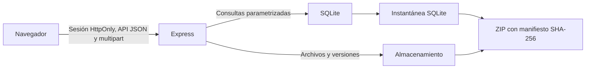
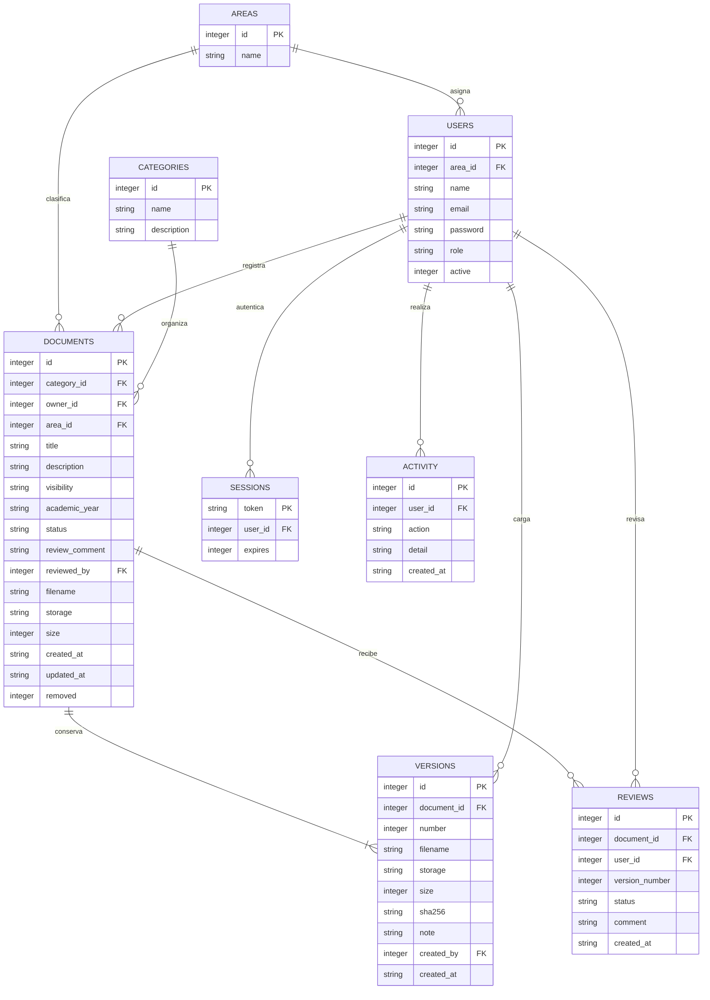

# Arquitectura y modelo de datos

La aplicación tiene un servidor Node.js/Express, una interfaz HTML/CSS/JavaScript sin compilación y una base SQLite. El servidor aplica autenticación y permisos en cada operación; ocultar un botón no es el mecanismo de autorización. Los archivos se sirven mediante rutas autenticadas y se almacenan con nombres aleatorios fuera de `public/`.

`documents` apunta al archivo actual; `versions` conserva cada carga, incluida la inicial. `(document_id, number)` es único. Una decisión en `reviews` registra el número de versión evaluado. Las decisiones anteriores a la incorporación de ese campo conservan valor nulo, mostrado como «Versión no registrada»; no se inventa el dato histórico.

Los cambios de metadatos, archivos y restauración ponen el estado en Pendiente. La aprobación controla la lectura compartida; propietarios y gestores mantienen acceso operativo. Las áreas son unidades configurables, no un catálogo fijo de carreras.

Las migraciones usan `PRAGMA user_version` y transacciones. El esquema de la primera versión se migra de forma aditiva, con copia previa. La nueva carga escribe un archivo aleatorio y confirma metadatos, versión y auditoría en una transacción; si falla, revierte los registros y retira ese archivo. Los archivos de versiones anteriores son inmutables en las operaciones del sistema.

El respaldo usa `VACUUM INTO`, elimina sesiones de la instantánea y recoge archivos sin intercalar otras solicitudes en el mismo proceso. Un bloqueo por carpeta impide otra instancia de esta aplicación. La restauración valida rutas, tamaños, hashes, integridad SQLite, claves foráneas y existencia de archivos referenciados; conserva una copia preventiva y revierte el reemplazo ante errores recuperables. No es una garantía contra un corte de energía durante el reemplazo; para ese escenario se conserva el ZIP preventivo y debe repetirse la recuperación con el servidor detenido.

Las fechas se almacenan en UTC; la interfaz presenta las fechas con la configuración del navegador. La base usa claves foráneas e índices para filtros y versiones. Las sesiones caducan en ocho horas y las contraseñas se derivan con scrypt. Para redes externas debe añadirse HTTPS en la infraestructura.
